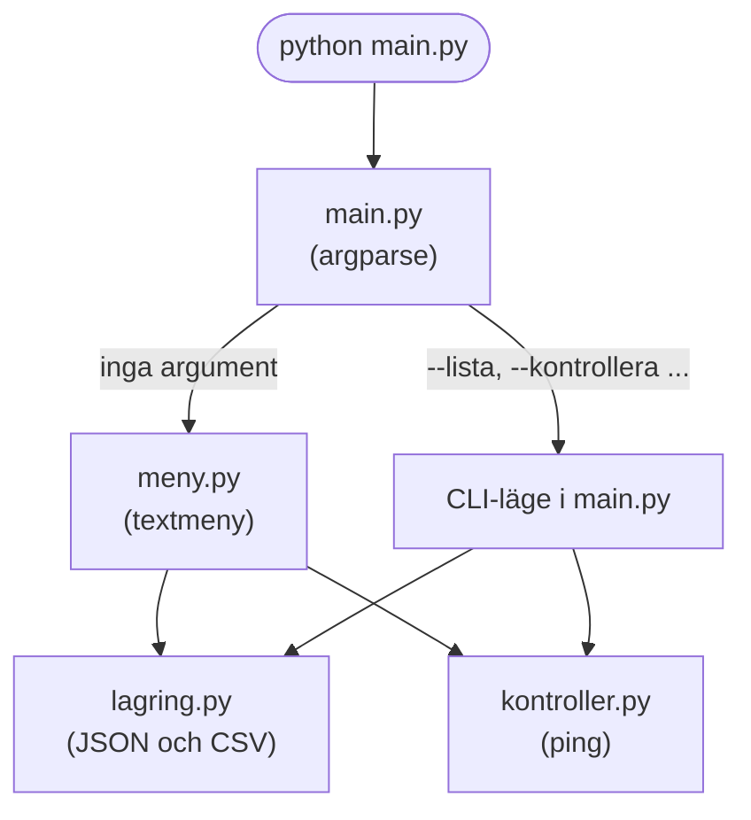

# Inlämningsuppgift: Server Inventory Tool

## I den här uppgiften ska du

- bygga ett eget, komplett, Python-program från grunden
- använda variabler, villkor, loopar, listor, dictionaries och funktioner
- dela upp programmet i moduler
- spara data i JSON och exportera rapporter som CSV
- läsa konfiguration från en miljövariabel
- använda moduler från standardbiblioteket som `pathlib`, `datetime`, `subprocess` och `sys`
- bygga både en textmeny och ett CLI-verktyg med `argparse`
- förklara och motivera de val du gör i koden

Allt du behöver för att klara uppgiften har vi gått igenom.

## Bakgrund

Under kursen har vi byggt *Service Status Tool* steg för steg, kapitel för kapitel. Nu är det dags för dig att visa att du kan använda samma kunskaper på egen hand i ett nytt projekt.

I många organisationer finns ett behov av att hålla reda på vilka servrar som finns, vad de används till, i vilken miljö de körs och om de faktiskt svarar på nätverkstrafik. Stora företag använder färdiga system för det här, men det är mycket vanligt att en DevOps Engineer skriver egna små verktyg som löser just det problem som teamet har. Det är precis ett sådant verktyg du ska bygga: *Server Inventory Tool*.

Programmet ska kunna:

- hålla reda på ett antal servrar med namn, adress, miljö, roll och status
- spara servrarna i en JSON-fil så att de finns kvar mellan körningarna
- kontrollera om servrarna svarar på ping
- exportera en rapport som CSV
- användas på två sätt: via en textmeny och direkt från kommandoraden

> Uppgiften liknar *Service Status Tool* med flit, men den är inte samma program. Du får så klart använda allt vi gått genom som stöd och slå upp hur saker fungerar, men koden ska vara skriven för det här projektet. Att kopiera kursprojektet och byta namn på variablerna räcker inte för att bli godkänd.

## Uppgiften i korthet

Uppgiften består av två delar:

Godkänd-delen (G)
: Ett fungerande program som uppfyller alla G-krav, en `README.md` och en skriftlig redogörelse i `REDOGORELSE.md`.

Väl Godkänd-delen (VG)
: Allt i G-delen, minst två fördjupningar som du väljer själv och en skriftlig reflektion i `REFLEKTION.md` där du värderar de val du har gjort.

För att få betyget G måste samtliga G-krav vara uppfyllda. För att få betyget VG måste samtliga G-krav och samtliga VG-krav vara uppfyllda.

## Projektstruktur

Följande struktur rekommenderas. Den liknar den vi byggt i kursen. Du får ändra filnamnen om du har goda skäl, men varje fil ska ha ett tydligt ansvar och det ska framgå i `README.md`.

```text
server-inventory-tool/
│
├── main.py            ← startpunkt, läser argument med argparse
├── meny.py            ← textmenyn och dess funktioner
├── lagring.py         ← läser och sparar JSON, exporterar CSV
├── kontroller.py      ← kontrollerar om servrar svarar
├── servrar.json       ← sparad data
├── .gitignore
├── README.md
├── REDOGORELSE.md
└── REFLEKTION.md      ← bara för VG
```

Så här kan modulerna hänga ihop:



Lägg märke till att både menyn och CLI-läget använder *samma* funktioner för lagring och kontroller. Logiken skrivs alltså en gång och återanvänds. Det är en av de viktigaste sakerna att få till i uppgiften.

## Startdata

Programmet ska fungera med följande startdata. Du sparar den som `servrar.json` i projektets rotkatalog:

```json
[
  {
    "namn": "web01",
    "adress": "example.com",
    "miljo": "prod",
    "roll": "webbserver",
    "status": "unknown",
    "senast_kontrollerad": ""
  },
  {
    "namn": "db01",
    "adress": "127.0.0.1",
    "miljo": "prod",
    "roll": "databas",
    "status": "unknown",
    "senast_kontrollerad": ""
  },
  {
    "namn": "test01",
    "adress": "192.0.2.10",
    "miljo": "test",
    "roll": "testserver",
    "status": "unknown",
    "senast_kontrollerad": ""
  },
  {
    "namn": "dev01",
    "adress": "localhost",
    "miljo": "dev",
    "roll": "utvecklingsserver",
    "status": "unknown",
    "senast_kontrollerad": ""
  }
]
```

`example.com`
: en domän som är reserverad för exempel och dokumentation. Den svarar på ping i de flesta nätverk.

`127.0.0.1` och `localhost`
: din egen dator. Den svarar alltid på ping.

`""`
: en tom sträng. Servern har alltså inte kontrollerats ännu.

> Vissa nätverk, till exempel en del skol- och företagsnätverk, blockerar ping mot internet. Om `example.com` inte svarar är det inte nödvändigtvis fel i din kod. Programmet ska då bara markera servern som `down`.

## Godkänd-delen (G)

Du ska bygga ett program som uppfyller samtliga krav nedan. Kraven är numrerade så att det blir lätt för dig att stämma av dem.

### Data

**G1** - Varje server lagras som en dictionary med nycklarna `namn`, `adress`, `miljo`, `roll`, `status` och `senast_kontrollerad`. Alla servrar hålls i en lista medan programmet körs.

**G2** - Giltiga värden för `miljo` är `dev`, `test` och `prod`. Giltiga värden för `status` är `up`, `down` och `unknown`. När en ny server läggs till får den alltid statusen `unknown`.

**G3** - När en server läggs till ska programmet kontrollera att miljön är giltig. Om den inte är det ska programmet säga till och fråga igen tills användaren anger ett giltigt värde.

**G4** - Det ska inte gå att lägga till två servrar med samma namn.

### Lagring

**G5** - Servrarna läses in från en JSON-fil när programmet startar och sparas till samma fil varje gång något ändras.

**G6** - Namnet på datafilen läses från miljövariabeln `INVENTORY_DATAFIL`. Om variabeln inte är satt används `servrar.json` som standardvärde.

**G7** - Om datafilen inte finns ska programmet starta med en tom lista i stället för att krascha. (`Path` och `exists()`)

**G8** - Programmet kan exportera alla servrar till en CSV-fil med en rubrikrad. Filen sparas i katalogen `rapporter/` och filnamnet innehåller datum och tid, till exempel `rapporter/inventering_2026-11-03_1337.csv`. Katalogen skapas automatiskt om den inte finns.

### Kontroller

**G9** - Programmet kan kontrollera om en server svarar på ping med `subprocess.run()`. Kommandot skickas som en lista och exitkoden avgör om servern svarar.

**G10** - Efter en kontroll uppdateras `status` till `up` eller `down`. Fältet `senast_kontrollerad` får aktuellt datum och tid i formatet `ÅÅÅÅ-MM-DD TT:MM`. Ändringen sparas till JSON-filen.

> Kommandot `ping` med flaggan `-c` fungerar på Linux och macOS. På Windows används andra flaggor. Om du arbetar på Windows kan du köra programmet i kursens container-miljö eller i WSL. Använd den server du fått på cloud2 så kommer många problem lösa sig automatiskt.

### Textmeny

**G11** - När programmet startas utan argument visas en textmeny som körs i en loop tills användaren väljer att avsluta. Menyn ska minst innehålla:

- visa alla servrar
- visa servrar i en viss miljö
- lägga till en server
- ta bort en server
- kontrollera en server
- kontrollera alla servrar
- exportera rapport som CSV
- avsluta

**G12** - Ogiltiga menyval ska ge ett begripligt meddelande och menyn ska visas igen. Om användaren anger namnet på en server som inte finns ska programmet säga det.

**G13** - Om användaren försöker ta bort en server i miljön `prod` ska programmet be om en extra bekräftelse innan servern tas bort.

**G14** - Utskriften av servrar ska vara lätt att läsa, med kolumner som står i linje. (f-strings och `:<15`)

### Kommandoraden

**G15** - `main.py` använder `argparse` och har en hjälptext som visas med `--help`. Programmet ska minst stödja:

| Kommando | Vad som händer |
|---|---|
| `python main.py` | Textmenyn startar. |
| `python main.py --lista` | Alla servrar skrivs ut och programmet avslutas. |
| `python main.py --lista --miljo prod` | Bara servrar i miljön `prod` skrivs ut. |
| `python main.py --kontrollera web01` | Servern `web01` kontrolleras. |
| `python main.py --kontrollera-alla` | Alla servrar kontrolleras. |
| `python main.py --export` | En CSV-rapport skapas. |

**G16** - Programmet avslutas med exit code `0` när allt gick bra. Efter `--kontrollera` och `--kontrollera-alla` ska exit code vara `1` om minst en server är nere. Om servern som anges med `--kontrollera` inte finns ska programmet också avslutas med exit code `1`. (`sys.exit()`)

> Med G16 kan ditt verktyg användas i ett bashskript eller i en CI/CD-pipeline. Pipelinen behöver inte läsa texten, den tittar bara på exitkoden. Du kan prova med `echo $?` direkt efter att programmet har körts.

### Struktur och best practice

**G17** - Programmet är uppdelat i minst tre egna moduler med tydliga ansvarsområden och `main.py` är programmets startpunkt med `if __name__ == "__main__":`.

**G18** - Koden följer de riktlinjer vi har använt i kursen:

- beskrivande namn i `snake_case` för variabler och funktioner, utan å, ä och ö
- varje funktion har en tydlig uppgift och tar emot det den behöver som parametrar
- kommentarer finns där koden inte förklarar sig själv
- samma logik finns inte i flera kopior, till exempel ska kontrollen av en server bara vara skriven på ett ställe
- inga lösenord, nycklar eller andra hemligheter i koden
- `.gitignore` innehåller åtminstone `__pycache__/` och `rapporter/`

**G19** - `README.md` beskriver vad programmet gör, vad som krävs för att köra det, hur programmet startas i båda lägena, hur miljövariabeln används och hur projektet är uppbyggt. *Det räcker inte med ett stycke, du skall ha en omfattande dokumentation.*

### Skriftlig redogörelse - `REDOGORELSE.md`

**G20** - I `REDOGORELSE.md` ska du svara kort, med egna ord, på frågorna nedan. Några meningar per fråga räcker, men varje svar ska hänvisa till konkreta ställen i din egen kod (fil och funktion).

1. Välj tre olika konstruktioner i koden, till exempel ett villkor, en loop och en funktion med parametrar och `return`. Förklara hur syntaxen fungerar och vad koden gör.
2. Varför passar en lista med dictionaries för att lagra servrarna? Vilka datatyper har värdena i en server?
3. Varför sparar du data i JSON men exporterar rapporten som CSV?
4. Hur är programmet uppdelat i moduler och funktioner? Vilket ansvar har varje fil?
5. Vilka moduler från standardbiblioteket använder du och till vad?
6. Ge tre exempel på god praxis från din kod och förklara varför de är bra.
7. Vilka källor och hjälpmedel har du använt och till vad? Det kan till exempel vara kursboken, dokumentation, forum eller AI-verktyg.

> Tänk på att du inte ska svara med en mening, utan redogöra för hur och varför.

## Väl Godkänd-delen (VG)

För VG ska du visa att du självständigt kan tillämpa kursinnehållet och att du kan reflektera över och värdera de val du har gjort. VG-delen består av två delar: fördjupningar och en skriftlig reflektion.

### Fördjupningar

**VG1** - Du ska välja och genomföra *minst två* av fördjupningarna nedan. Varje fördjupning ska beskrivas i `README.md` och motiveras i `REFLEKTION.md`. De flesta bygger direkt på genomgångarna, men ett par kräver att du söker upp lite information själv.

HTTP-kontroll
: För servrar med rollen `webbserver` görs även en HTTP-kontroll genom att köra `curl` via `subprocess.run()`. Du tar själv reda på vilka flaggor till `curl` som behövs för att exitkoden ska visa om sidan svarade och för att kommandot inte ska vänta för länge.

Historik
: Varje kontroll sparas i en historik per server med tidpunkt och resultat. Programmet kan visa de senaste kontrollerna för en server, både i menyn och med ett eget argument på kommandoraden.

Rapport med sammanfattning
: CSV-exporten kompletteras med en textrapport som visar hur många servrar som är `up`, `down` och `unknown`, både totalt och per miljö.

Konfigurationsfil
: Programmet läser inställningar som datafil och rapportkatalog från en `config.json`. En miljövariabel ska gå före värdet i konfigurationsfilen och ett standardvärde används om ingetdera finns. Ordningen ska beskrivas i `README.md`.

Säkrare inmatning
: Programmet frågar igen när användaren lämnar ett fält tomt, när namnet innehåller mellanslag eller när ett menyval inte finns, i stället för att gå vidare med felaktiga värden. Du söker själv upp vilka strängmetoder som kan hjälpa dig.

`--verbose`
: En flagga `--verbose` gör att programmet skriver ut mer information, till exempel exakt vilket kommando som körs och vilken datafil som används.

> Du får genomföra en egen fördjupning som inte står i listan, så länge den har ungefär samma omfattning. Stäm i så fall av idén med mig innan du börjar.

### Skriftlig reflektion - `REFLEKTION.md`

**VG2** - I `REFLEKTION.md` ska du reflektera över och värdera minst fyra val som du har gjort under arbetet. För varje val ska du beskriva:

- vilket val du gjorde
- vilka alternativ som fanns
- varför du valde som du gjorde
- vilka konsekvenser valet har, både fördelar och nackdelar
- vad du skulle göra annorlunda om förutsättningarna ändrades

Minst två av de fyra valen ska komma från listan nedan:

- att hålla servrarna i en lista med dictionaries i stället för till exempel en dictionary med serverns namn som nyckel
- att spara efter varje ändring i stället för bara när programmet avslutas
- hur programmet är uppdelat i moduler och funktioner och hur det påverkar möjligheten att bygga vidare på det
- att konfigurera datafilen med en miljövariabel i stället för att skriva filnamnet i koden
- att använda `subprocess` och befintliga kommandon som `ping` i stället för att skriva kontrollen själva i Python
- varför kommandot till `subprocess.run()` skickas som en lista
- att erbjuda både en textmeny och ett CLI-läge

**VG3** - Reflektionen ska också resonera kring vad som skulle behöva ändras om verktyget skulle användas i en större miljö, till exempel med 1 000 servrar eller köras automatiskt varje natt i en pipeline.

**VG4** - Reflektionen ska vara skriven med egna ord och hänvisa till konkreta ställen i koden. Det räcker inte att beskriva vad koden gör: du ska visa att du förstår *varför* och kan värdera för- och nackdelar. En rimlig omfattning är två till tre sidor.

> Ett bra sätt att pröva en reflektion är att fråga sig: "Skulle någon som inte har sett koden förstå vilket val jag gjorde och om det var ett bra val?" Om svaret är ja är du på rätt väg.

## Bedömning

### Koppling till kursmålen

Tabellen visar hur kraven i uppgiften hänger ihop med kursmålen i kursplanen.

| Kursmål | Visas genom | Krav |
|---|---|---|
| Redogöra för syntax för programspråket Python | Fungerande kod och förklaring av egna konstruktioner | G3, G11-G16, G20 |
| Välja lämpliga datatyper och datastrukturer | Lista med dictionaries, JSON och CSV | G1, G2, G5, G8, G20 |
| Redogöra för metoder för att strukturera program med moduler och funktioner | Modulindelning och återanvänd logik | G17, G18, G20 |
| Kunna söka och hitta relevanta programbibliotek och använda dem | Val och användning av moduler i standardbiblioteket | G7-G9, G15, G20 |
| Bygga interaktiva program med textbaserade användargränssnitt | Textmeny och CLI-verktyg | G11-G16 |
| Använda standardbibliotek och följa god praxis | `json`, `csv`, `os`, `pathlib`, `datetime`, `subprocess`, `argparse`, `sys`, README och kodstil | G5-G10, G15-G19 |

> Jag har medvetet tagit bort klasser och grafiskt gränssnitt från uppgiften. Ni har programmerat i Java som är helt objektorienterande, vilket gett er klasser och den grafiska delen skulle bara komplicera till uppgiften för er. Uppgiften är omfattande nog som den är.

### Godkänd (G)

För betyget G ska:

- samtliga krav G1-G20 vara uppfyllda
- programmet gå att starta och använda i båda lägena enligt instruktionerna i `README.md`
- `REDOGORELSE.md` visa att du förstår och kan förklara din egen kod

### Väl Godkänd (VG)

För betyget VG ska:

- samtliga krav för G vara uppfyllda
- minst två fördjupningar vara genomförda och fungera (VG1)
- `REFLEKTION.md` med säkerhet värdera de val som har gjorts och vilken effekt de har (VG2-VG4)

### Icke Godkänd (IG)

Om något av G-kraven saknas eller inte fungerar blir betyget IG. Det gäller också om programmet inte går att starta enligt instruktionerna i `README.md`.

## Inlämning

Inlämningen görs på LearnPoing. Du lämnar in en länk till ett Git-repo (till exempel på GitHub) som jag har läsbehörighet till. Det ska alltså vara ett publikt repo, eller att du lagt till `jonasbjork` som collaborator.

Kan jag inte komma åt ditt repo har jag inget att bedöma och kan inte sätta betyg på dig.

Inlämningen ska innehålla alla filer i projektstrukturen ovan, men *inte* katalogen `__pycache__/` eller genererade rapporter.

> Innan du lämnar in är det klokt att packa upp eller klona projektet i en ny, tom katalog och följa instruktionerna i din egen `README.md` från början. Om programmet startar där, kommer det med stor sannolikhet att fungera även för mig.

## Checklista inför inlämning

- [ ] Programmet startar utan argument och textmenyn fungerar
- [ ] `--lista`, `--miljo`, `--kontrollera`, `--kontrollera-alla`, `--export` och `--help` fungerar
- [ ] Exitkoderna är rätt efter `--kontrollera` och `--kontrollera-alla`
- [ ] Ändringar finns kvar efter att programmet har startats om
- [ ] Programmet startar även när `servrar.json` saknas
- [ ] `INVENTORY_DATAFIL` styr vilken datafil som används
- [ ] CSV-rapporten hamnar i `rapporter/` med datum och tid i filnamnet
- [ ] Ogiltiga menyval och ogiltiga miljöer hanteras utan att programmet avslutas
- [ ] `.gitignore` och `README.md` finns och är uppdaterade
- [ ] `REDOGORELSE.md` besvarar alla sju frågor med hänvisningar till koden
- [ ] För VG: minst två fördjupningar och `REFLEKTION.md`
